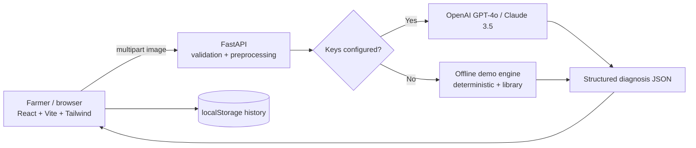

# Plant Disease Detector


> Snap a leaf photo → get instant disease diagnosis with severity, confidence,
> treatment, and prevention. Works **offline in demo mode** (no API keys) and
> upgrades to GPT-4o / Claude 3.5 Sonnet when keys are provided.

Built for farmers, extension workers, and classrooms: mobile-first UI, Hindi /
Marathi strings, history, printable reports, and a hardened FastAPI backend.

---

## Table of contents

- [Why this is useful](#why-this-is-useful)
- [Features](#features)
- [Screenshots](#screenshots)
- [Architecture](#architecture)
- [Quick start (2 min demo, no keys)](#quick-start-2-min-demo-no-keys)
- [Full setup (AI providers)](#full-setup-ai-providers)
- [Configuration](#configuration)
- [API reference](#api-reference)
- [Disease library](#disease-library)
- [Project structure](#project-structure)
- [Development](#development)
- [Testing](#testing)
- [Docker](#docker)
- [Accessibility & i18n](#accessibility--i18n)
- [Security](#security)
- [Roadmap](#roadmap)
- [Contributing](#contributing)
- [License](#license)

## Why this is useful

- Early detection saves crops: clear severity + confidence + next steps.
- Low-friction: drag-drop photo, one tap analyze, printable/shareable report.
- Works everywhere: demo mode for classrooms/offline, real LLM vision for
  production, PWA-ready responsive UI with dark mode.

## Features

- **Instant analysis** — drag-drop upload, inline validation, staged progress.
- **Demo mode** — deterministic offline diagnosis + sample gallery, zero keys.
- **Two AI providers** — OpenAI GPT-4o and Anthropic Claude 3.5 Sonnet.
- **Rich reports** — severity badge, confidence ring, symptoms, affected area,
  treatment timeline, prevention calendar, copy/print/share.
- **History** — localStorage recent analyses with restore, export, clear.
- **Disease library** — 8 common diseases with symptoms and prevention.
- **Farmer-first UX** — mobile-first, keyboard accessible, reduced-motion safe,
  Hindi/Marathi strings, toasts, empty/loading/error states.
- **Hardened API** — Pillow verification, size guards, rate limits, security
  headers, structured logging, health/version endpoints.

## Screenshots

> Place captures in `docs/screenshots/` (see `docs/SCREENSHOTS.md`).

| Home / upload | Analyzing | Report |
|---|---|---|
| `01-home.png` | `02-analyzing.png` | `03-report.png` |

## Architecture



See `docs/ARCHITECTURE.md` for request flow, limits, and failure modes.

## Quick start (2 min demo, no keys)

**Backend (demo mode):**

```bash
cd backend
python -m venv .venv
# Windows: .venv\Scripts\activate
source .venv/bin/activate
pip install -r requirements.txt
uvicorn app.main:app --reload --port 8000
```

Open http://localhost:8000/docs — try `POST /api/v1/detect` with any leaf
photo. Without keys the API returns a clearly-labeled `demo` diagnosis.

**Frontend:**

```bash
cd frontend
npm install
npm run dev
```

Open http://localhost:5173. Pick **Use demo image** or upload your own —
no backend required for demo mode.

## Full setup (AI providers)

```bash
cd backend
cp .env.example .env
# edit .env — add OPENAI_API_KEY and/or ANTHROPIC_API_KEY
uvicorn app.main:app --reload --port 8000

cd ../frontend
cp .env.example .env   # optional: VITE_API_BASE, VITE_DEMO_MODE
npm install
npm run dev
```

Frontend proxies `/api` → `http://localhost:8000` in dev (see
`frontend/vite.config.js`).

## Configuration

Backend (`backend/.env`):

```env
OPENAI_API_KEY=
ANTHROPIC_API_KEY=
DEFAULT_LLM_PROVIDER=openai
DEBUG=True
CORS_ORIGINS=http://localhost:5173,http://localhost:3000
RATE_LIMIT_PER_MINUTE=60
MAX_FILE_SIZE_MB=10
```

Frontend (`frontend/.env`):

```env
VITE_API_BASE=/api/v1
VITE_DEMO_MODE=auto
```

## API reference

Interactive docs: `http://localhost:8000/docs`.

| Method | Path | Description |
|---|---|---|
| `POST` | `/api/v1/detect` | Multipart `file` + `provider`, `include_treatment`, `include_prevention` |
| `GET` | `/api/v1/health` | `status`, `version`, `providers_available`, `demo_mode` |
| `GET` | `/api/v1/providers` | Configured providers + demo availability |
| `GET` | `/api/v1/version` | Service name + version |
| `GET` | `/api/v1/diseases` | Curated library (8 entries) |
| `POST` | `/api/v1/feedback` | `{ detection_id, rating, comment }` stub for learning loop |

Example:

```bash
curl -X POST http://localhost:8000/api/v1/detect \
  -F "file=@leaf.jpg;type=image/jpeg" \
  -F "provider=openai" \
  -F "include_treatment=true" \
  -F "include_prevention=true"
```

See `docs/API_EXAMPLES.md` for responses, errors, and demo payload.

## Disease library

`GET /api/v1/diseases` + in-app **Library** tab: early/late blight, powdery
mildew, leaf spot, rust, mosaic virus, bacterial spot, healthy leaf — each
with symptoms, severity hints, and prevention.

## Project structure

```text
plant-disease-detector/
  backend/
    app/
      api/routes.py        # REST endpoints
      core/config.py       # env-driven settings
      models/schemas.py    # Pydantic contracts
      services/
        llm_vision.py      # OpenAI/Anthropic + safe parsing
        demo.py            # offline deterministic engine
        image.py           # Pillow verify/normalize
        library.py         # curated disease data
      main.py              # app factory, middleware, lifespan
    tests/                 # pytest suite
    Dockerfile
    pyproject.toml
  frontend/
    src/
      components/          # Header, Hero, UploadZone, ResultDisplay, ...
      utils/api.js         # timeout/retry/demo client
      utils/demo.js        # offline sample results
      utils/history.js     # localStorage store
      utils/i18n.js        # en/hi/mr strings
      styles/index.css     # design system
      App.jsx              # tab state machine
    index.html             # SEO/PWA/meta
  docs/                    # architecture, demo, e2e, screenshots
  .github/workflows/ci.yml
```

## Development

```bash
# backend
cd backend
pip install -e ".[dev]"
ruff check app tests
pytest -q

# frontend
cd frontend
npm run lint
npm run build
```

## Testing

- Backend: `pytest -q` (validation, demo, library, feedback, health).
- Frontend: `npm run lint && npm run build`; manual checklist in
  `docs/E2E_CHECKLIST.md`.
- CI runs both on push/PR (see `.github/workflows/ci.yml`).

## Docker

```bash
docker build -t plant-detector ./backend
docker run -p 8000:8000 --env-file backend/.env plant-detector

# or full stack
docker compose up --build
```

## Accessibility & i18n

- Keyboard-first, focus-visible rings, ARIA live regions for progress/toasts.
- `prefers-reduced-motion` disables non-essential animation; contrast-checked
  severity badges; 44px touch targets.
- English + Hindi + Marathi UI strings (`src/utils/i18n.js`), persisted choice.

## Security

- Never commit `.env`. Keys stay server-side; frontend never sees them.
- Size/MIME/Pillow verification, rate limiting, security headers, CORS
  allowlist. See `SECURITY.md` for reporting.

> This is a decision-support prototype, not a certified diagnostic device.
> Confirm treatment with a local extension officer.

## Roadmap

- [x] v2.0 offline demo, hardened API, premium UI, history, i18n stub
- [ ] Field pilot + feedback learning loop
- [ ] PWA offline capture + background sync
- [ ] Regional language expansion + voice input

## Contributing

See `CONTRIBUTING.md`. Run `pytest -q` and `npm run lint` before PRs.

## License

MIT — see [LICENSE](./LICENSE) and [NOTICE](./NOTICE).
Built with care by [kv-creates](https://github.com/kv-creates).
