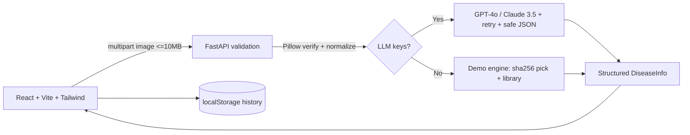

# Architecture

## Key decisions

- Pillow is source of truth for images; `python-magic` optional (Windows-safe).
- Demo mode is deterministic and labeled — never mistaken for live vision.
- Rate limit is in-process (60/min); use Redis/ingress for multi-replica prod.
- Frontend degrades gracefully: API down → demo diagnosis + toast.
- History never leaves the browser; feedback endpoint is a stub for review.
